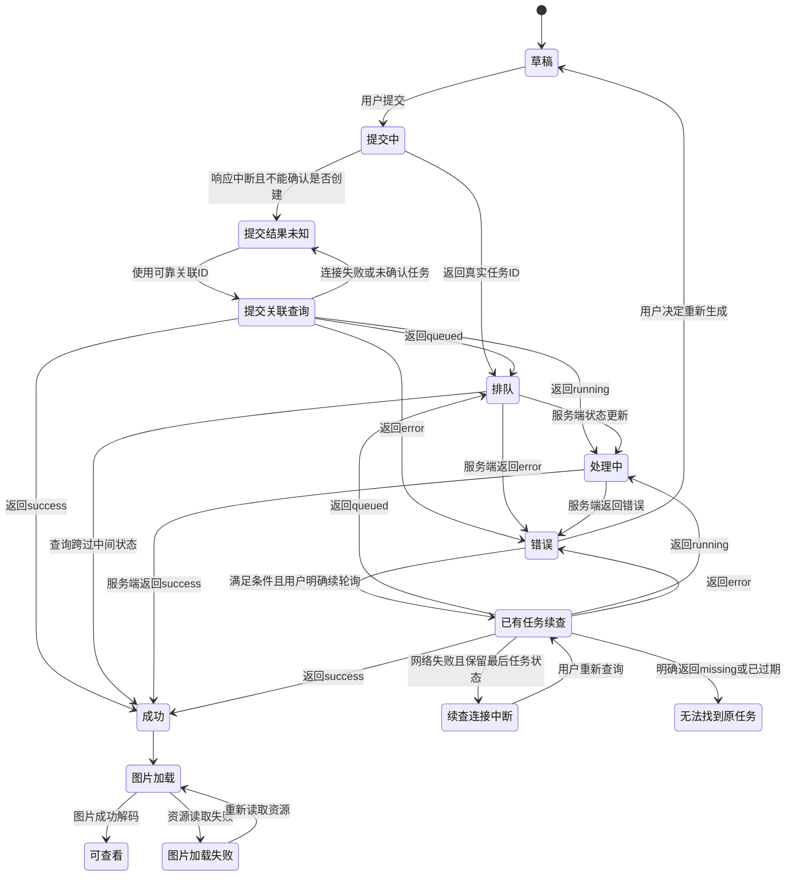

# chatgpt2api 全站玻璃风格与动态交互设计文档

版本：V1.0 实施基准

日期：2026 年 10 月 20 日，北京时间

覆盖：生图、号池管理、图片管理、日志管理、调试、设置

设计基准：用户提供的参考图与当前优化后的号池页

交付性质：产品与前端设计方案。文中新增组件、交互和架构均为拟实施设计，不表示已经上线。

## 1 设计目标与必须达成的结果

将六个业务板块统一为一套具有苹果界面气质的工作台：固定的左侧导航、轻盈的玻璃功能层、清晰的内容层，以及能够连续响应操作的动态组件。用户从任意板块进入、刷新或切换页面，都应感到仍在同一个应用中。

这次最重要的变化是把左侧导航提升为全站公共结构。它不再属于号池页面，也不依赖号池标题或表格是否出现。

### 1.1 强制验收项

1. 桌面端六个板块全部在最左侧纵向排列，顺序固定为：生图、号池管理、图片管理、日志管理、调试、设置。
2. 顶部工具栏保留当前位置、命令入口、任务状态、主题和用户菜单；不再横向摆放这六个主导航入口。
3. 六个路由直接访问、刷新、前进、后退、相互跳转时，导航位置、宽度、图标、选中样式一致。
4. 手机端以左侧滑出的导航抽屉承载六个入口，顶部只保留打开侧栏的按钮；不恢复为横向主导航。
5. 当前号池页作为视觉基准，其他五页达到相同完成度；号池页也迁入同一公共布局。
6. 动态效果覆盖操作前、操作中、成功、失败和恢复过程。动画不能代替真实状态，也不能阻止用户继续操作。
7. 保留现有功能、权限、数据范围和关键业务语义。管理员看到完整六项，普通用户仅看到已有权限允许的入口；导航隐藏不代替服务端鉴权。

### 1.2 本文提供的设计深度

- 一套全局布局、浅色与深色材质规范。
- 48 个公共动态组件或交互模式的具体说明。
- 六个板块各 8 组核心交互，共 48 组页面场景。
- 动效时间、缓动、弹性、打断、键盘、触摸和减弱动态规则。
- 任务真实性、敏感内容、未保存状态、错误恢复与实施验收标准。

这里的“动态丰富”指每个关键操作都有完整反馈。默认静止页面保持安静，用户操作和真实任务变化才触发相应动态。

## 2 当前页面为什么不一致

当前扩展的 `decorate()` 在 `web_dist/account-pool-layout.js:42` 只对 `/accounts` 激活样式，并在离开该路由时移除布局标记。左栏实际上来自共享顶栏中的 `<nav>`，再由号池 CSS 改成固定侧栏。因此其他页面恢复顶部导航，是当前实现的明确行为。

| 当前事实 | 代码锚点 | 下一版设计处理 |
| --- | --- | --- |
| 布局仅在号池路由激活 | `web_dist/account-pool-layout.js#decorate:42` | 改为六个路由共用持久化 AppShell |
| 依赖号池 h1 定位页面 | `web_dist/account-pool-layout.js#decorate:53` | 由路由表识别页面，公共导航不依赖页面 DOM |
| 从 header 中取 nav 装饰成侧栏 | `web_dist/account-pool-layout.js#decorate:63` | 直接定义独立 Sidebar 与 Topbar |
| 样式全部挂在号池专用 body 标记上 | `web_dist/account-pool-layout.css:1` | 拆为全局主题令牌、公共组件、页面专用样式 |
| 图片管理图标映射使用 `/images` | `web_dist/account-pool-layout.js#decorate:69` | 导航统一使用真实页面路由 `/image-manager`；`/images/{path}` 保留为资源路径 |
| 服务端统一提供静态页面及扩展脚本 | `api/app.py#serve_web:62`、`#extended_page:78` | 保持路由和接口兼容，统一构建新的前端资源 |

当前发布目录以 `web_dist` 编译产物为主。另有历史 TSX 副本，可用于理解组件，但未经差异合并不能视为当前线上源码。全站实施前需要恢复可构建前端，并合并已经部署的会话导入、账号操作、图片清理、传输设置等扩展。

## 3 视觉方向

### 3.1 推荐方案

采用“清透的导航与操作层 + 高可读的内容层”。保留现有号池页的浅蓝、白色、圆角和柔和光感，将玻璃效果集中到左侧栏、顶部工具栏、浮动操作条、菜单及抽屉。

账号表格、日志正文、代码和设置表单使用接近实色的底板。图片保持原色，图片像素上不覆盖蓝色滤镜。这样可以获得玻璃的空间感，同时维持长时间使用的清晰度。

这一层次参考 Apple 对材质的区分：Liquid Glass 用于导航和控件所在的功能层，内容区域采用更安静的材质。下面的具体尺寸、颜色和时长都是本项目设计值。[Apple 材质指南](https://developer.apple.com/design/human-interface-guidelines/materials)

### 3.2 三种风格的取舍

| 方向 | 特征 | 取舍 |
| --- | --- | --- |
| 推荐：清透工作台 | 蓝白色调、局部玻璃、细边框、克制阴影、连续交互 | 最接近现有号池页，也适合表格、日志和设置等高密度场景 |
| 更轻：近实色工作台 | 大面积白底、低透明度、少量浮层动态 | 作为减少透明度或性能受限时的模式 |
| 更强：高折射展示风格 | 大面积透明、背景形变、持续流光 | 容易影响文字与图片判断，不作为日常工作模式 |

### 3.3 延续和收敛

延续蓝色选中态、柔和高光、浅色统计卡和轻薄边框。收敛大面积装饰球、过大的导航按钮、过强的背景渐变和多层阴影。装饰不能与任务状态争夺注意力。

图标统一使用一套允许 Web 使用的线性图标；不直接打包系统字体或受限的系统图标资源。字体优先使用设备已有的系统字体，中文使用苹方或系统中文回退。

## 4 全站公共布局

### 4.1 桌面结构

```text
┌──────────────────────┬────────────────────────────────────────────────────┐
│ chatgpt2api           │ 当前板块 / 子页       命令入口  任务状态  用户菜单 │
│                      ├────────────────────────────────────────────────────┤
│  生图                │ 页面标题、说明、主要操作                            │
│  号池管理            │                                                    │
│  图片管理            │ 页面筛选 / 参数 / 状态概览                          │
│  日志管理            │                                                    │
│  调试                │ 主内容：画布 / 表格 / 图片网格 / 表单                │
│  设置                │                                    ┌─────────────┐ │
│                      │                                    │ 按需检视器  │ │
│  折叠侧栏            │                                    │ 详情与操作  │ │
└──────────────────────┴────────────────────────────────────┴─────────────┴─┘
```

左侧栏和顶部工具栏在路由切换时保持挂载。只替换主内容区域。右侧检视器按需出现，关闭后回到原条目和滚动位置。

公共路由表固定如下；同一路由的尾斜杠形式归一化后判断选中态。

| 顺序 | 主入口 | 页面路由 | 可见范围 |
| --- | --- | --- | --- |
| 1 | 生图 | `/image` | 已获授权的管理员与普通用户 |
| 2 | 号池管理 | `/accounts` | 管理员 |
| 3 | 图片管理 | `/image-manager` | 管理员 |
| 4 | 日志管理 | `/logs` | 管理员 |
| 5 | 调试 | `/debug` | 保持现有管理面板角色范围，不因全局导航扩张权限 |
| 6 | 设置 | `/settings` | 管理员；普通用户已有独立接入入口按原规则保留 |

### 4.2 区域规则

| 区域 | 设计要求 |
| --- | --- |
| 左侧栏 | 宽屏默认 248px，外侧留白 16px，内部上下留白 16px；导航行高 48–52px；图标 22px，文字 15px；选中底板沿纵向移动 |
| 品牌区 | 固定在左侧栏顶部，标志 28px，品牌文字 20px；品牌入口回到生图页 |
| 顶部工具栏 | 高 60px，只放当前位置和全局操作；玻璃底板与内容之间有细分隔线 |
| 页面标题区 | 标题 30–32px，说明 14px；主要操作靠右，窄屏换行，不裁切操作文字 |
| 主内容区 | 常规间距 24px；紧凑列表区 16px；区域之间留白大于组件内部留白 |
| 右侧检视器 | 默认 360px，可选 420px 宽模式；不足以同时容纳主内容时改为覆盖抽屉 |
| 底部任务状态 | 使用顶部任务胶囊和按需任务面板；不常驻一个遮挡内容的大浮窗 |

侧栏折叠后宽度为 72px，图标位置保持一致。标签隐藏后提供 Tooltip 和可访问名称。折叠偏好保存在当前浏览器，不随页面切换重置。

选中样式采用浅蓝玻璃底板与清晰的文字强调；只保留一个主选中项。悬停样式弱于选中样式，鼠标经过其他入口不会造成“当前页改变”的错觉。

### 4.3 响应式规范

| 可用宽度 | 主导航 | 内容与详情 |
| --- | --- | --- |
| ≥1440px | 248px 完整左侧栏 | 可容纳主内容与右侧检视器 |
| 1024–1439px | 224px 完整左侧栏，可手动折叠 | 检视器根据剩余宽度覆盖显示 |
| 768–1023px | 72px 左侧图标栏；点击展开 248px 覆盖侧栏 | 主要内容单列，详情使用覆盖抽屉 |
| <768px | 左侧抽屉，宽度 `min(288px, 88vw)`；顶部仅一个菜单按钮 | 表单单列；表格在自身容器横滚；详情使用底部 Sheet 或全屏页 |

断点按 CSS 视口宽度判断。200% 缩放等效进入窄布局。六个主入口在所有宽度下都不变为顶部横向菜单。调试、设置内部的子页可以使用分段控件或二级列表，这与全局主导航分开。

手机侧栏中选择路由后，关闭抽屉并在目标内容可用时聚焦新页标题；不把焦点留在已隐藏的菜单项。点击遮罩、关闭按钮或 Esc 取消导航时，焦点返回打开侧栏的按钮。桌面导航保留被操作导航项的焦点，并播报新页面标题；前进后退优先恢复该页仍存在的阅读锚点。

## 5 颜色 字体与玻璃材质

### 5.1 视觉令牌

| 令牌 | 浅色建议 | 深色建议 | 用途 |
| --- | --- | --- | --- |
| 页面背景 | `#F3F6FB` | `#0D1422` | 整体工作区 |
| 主内容底板 | `#FFFFFF`，不透明度 96%–100% | `#182131`，96%–100% | 表格、表单、代码 |
| 主文字 | `#172237` | `#EDF2FC` | 标题与关键内容 |
| 次级文字 | `#66758B` | `#A8B5CA` | 说明和元信息 |
| 强调色 | `#3478F6` | `#78A7FF` | 当前选中、主要操作 |
| 成功 | `#16845B` | `#65D6A4` | 已确认成功 |
| 警告 | `#A66A00` | `#F2C46C` | 限流、需关注 |
| 错误 | `#CF3552` | `#FF8DA2` | 失败、破坏性操作 |
| 边框 | `#DDE5F0` | `#35435A` | 组件边界 |

状态必须同时有文字或图标，颜色不单独承担含义。最终对比度需在真实背景上测量，不能仅用两个色值的理论结果替代。

字体层级：页面标题 32/40，区域标题 20/28，正文 14/22，表格 12–13/20，辅助文字 12/18。数字使用等宽数字特性，避免额度或时间更新时左右抖动。主要交互命中区至少 44×44 CSS px；视觉较小的图标按钮通过透明内边距扩展命中区。

间距采用 4、8、12、16、24、32。输入控件圆角 10–12px，内容卡片 16–20px，侧栏与抽屉 22–24px。阴影以低透明度柔和分层为主，避免每一行、每一个按钮都有明显悬浮阴影。

### 5.2 材质分层

| 层级 | 用途 | 透明与模糊 | 动态表现 |
| --- | --- | --- | --- |
| L0 背景 | 全局底色与极淡蓝色光晕 | 无实时模糊 | 默认静止 |
| L1 内容 | 表格、表单、日志、图片网格 | 接近实色，默认不使用 backdrop blur | 数据更新时局部淡入 |
| L2 功能玻璃 | 侧栏、顶部栏、批量操作条 | 浅色白底约 78%–88%，静态模糊 16–20px | 高光与选中底板随操作变化 |
| L3 临时浮层 | 菜单、Popover、检视器 | 白底约 88%–94%，静态模糊 16–20px | 从触发点或屏幕边缘进入 |
| L4 决策层 | 确认弹窗、未保存提示 | 接近实色，遮罩独立 | 轻缩放与淡入，明确焦点 |

玻璃的动态感来自层与层的相对运动、内容从工具栏下面经过时的遮挡、边缘高光的变化。模糊半径不逐帧动画，不对每张图片或每行表格做独立背景模糊。

低性能模式与“减少透明度”将 L2/L3 替换为实色底板，保持边框、阴影和层级。深色模式使用独立令牌，不把浅色界面机械反色。参考 Apple 关于可读性、透明度与辅助功能适配的指导。[Apple Liquid Glass 适配指南](https://developer.apple.com/documentation/technologyoverviews/adopting-liquid-glass)

## 6 全局动效语言

### 6.1 动效时间表

| 名称 | 建议时长 | 使用范围 | 运动方式 |
| --- | --- | --- | --- |
| 即时 | 0ms | 键盘导航、焦点、输入字符、快捷键触发 | 直接到达结果状态 |
| 触感 | 100–140ms | 鼠标或触摸按钮按压、开关 | 缩放至 0.97 或短距离移动 |
| 轻反馈 | 120–180ms | 图标替换、状态颜色、筛选标签 | 透明度与颜色过渡 |
| 局部展开 | 180–220ms | Popover、下拉菜单、批量条 | 4–8px 位移 + 透明度 |
| 页面连续性 | 160–240ms | 路由内容切换、网格重排 | 6–10px 位移；保留公共框架 |
| 抽屉与预览 | 220–280ms 进入，140–180ms 退出 | 左侧抽屉、右侧检视器、图片预览 | 边缘滑入或共享位置过渡 |

入场曲线：`cubic-bezier(0.22, 1, 0.36, 1)`。位移曲线：`cubic-bezier(0.25, 1, 0.5, 1)`。大型抽屉可采用 `cubic-bezier(0.32, 0.72, 0, 1)`。

少数直接操控组件可以使用轻弹簧：初始建议 stiffness 500、damping 40、mass 1，按真实设备调校。拖动过程中跟随指针，不加缓动；释放时才吸附。侧栏选中、开关和预览落位不采用明显回弹。

以上为项目参数，不是 Apple 官方参数。Apple 的动效指导强调目的明确、支持中断、避免高频干扰，并让用户能够减少动态效果。[Apple 动效指南](https://developer.apple.com/design/human-interface-guidelines/motion)

### 6.2 统一规则

1. 只对 `transform`、`opacity` 做主要运动；颜色用于状态反馈。禁止 `transition: all`。
2. 折叠、重排和网格变化先确定最终布局，再用位置差值做 transform 过渡；不逐帧改变 width、height、top、left。
3. 进入比退出稍慢。关闭浮层时，模态栈和焦点一次性切换到上一层或原触发点；消费本次关闭事件，不能穿透点击底层按钮。退场残影不再接收事件，也不进入可访问树，不用残影阻塞下一次独立输入。
4. 同一元素连续切换时从当前视觉位置继续，不重新跳回动画起点。
5. 所有键盘触发的导航、菜单、切换和焦点处理直接完成；不让快捷操作等待位移动画。
6. 非用户触发的首次页面加载直接呈现可用结构；路由点击产生的切换才使用短过渡。大列表不逐行轮番飞入。
7. 用户主动展开的一组卡片最多前 6 项使用 25ms 错峰，整体延迟不超过 150ms。
8. 一个视口中最多同时存在 2 个持续动态反馈区域。只允许真实进行中的任务使用持续加载动画。
9. 文字编辑、代码阅读、日志查看时，周边装饰保持静止。禁止鼠标磁吸、全页面视差和持续漂浮卡片。
10. 页面后台、元素离屏或任务完成时暂停持续动画；不暂停服务器任务。

### 6.3 动态偏好

提供“标准、轻量、关闭”三个动态选项，以及独立的“减少透明度”。偏好保存到当前浏览器，所有六页共享。

- 标准：按时间表执行，状态变化完整反馈。
- 轻量：去掉位移、缩放、弹簧和共享元素移动，保留最多 80ms 的透明度变化。
- 关闭：状态立即切换，仍保留清晰的文字、图标和焦点。
- 检测到 `prefers-reduced-motion: reduce` 时，最高只启用轻量模式；用户主动选关闭仍然有效。

动效关闭后，功能、提交顺序、完成提示和错误信息必须完全相同。加载状态仍有静态图标、阶段文字和已等待时间。

## 7 公共动态组件目录

以下 48 项为可复用组件或动效模式。每项都必须支持第 6 节的键盘即时处理与动态降级，不需要每页重复实现。

目录描述最终设计范围。A06 命令面板、A07 全局任务胶囊、F08 全局任务面板属于第三阶段，其余 45 项在第一、二阶段完成适用场景。单页已有任务状态可先完成，不能因此声称全局任务聚合已经完成。

### 7.1 导航与公共框架

| 编号 | 组件 | 触发和动态 | 完整交互要求 |
| --- | --- | --- | --- |
| A01 | 全局玻璃侧栏 | 点击折叠，180–220ms 位置过渡 | 六页共享宽度与偏好；折叠时焦点仍在原按钮 |
| A02 | 导航选中底板 | 路由确认后，背景沿纵向移动 160ms | 快速连点直接重定向到最后目标；失败保持当前实际页面 |
| A03 | 导航图标反馈 | 悬停改变色彩，按下轻缩放 110ms | 不持续跳动；触摸不使用 hover 状态 |
| A04 | 顶部滚动边缘层 | 内容滚到工具栏下方时，阴影淡入 120ms | 仅改变边界，工具栏尺寸不跳动 |
| A05 | 页面内容切换器 | 用户点击主导航，旧内容退 100ms，新内容入 160ms | 侧栏、顶栏不重建；旧过渡层 inert 且 aria-hidden，始终只有一个可交互主视图 |
| A06 | 全局命令面板 | 点击或 Cmd/Ctrl+K 打开 | 点击时从工具入口展开；键盘立即显示并聚焦搜索；只搜索导航和允许的操作 |
| A07 | 全局任务胶囊 | 有进行中任务时显示图标、数量与状态 | 只汇总已知任务；点击打开任务面板；完成后不抢焦点 |
| A08 | 主题与动态控制 | 选择浅色、深色、跟随系统或动态档位 | 主题令牌一次性切换，避免所有组件同时渐变；选择即时持久化 |

### 7.2 输入和选择

| 编号 | 组件 | 触发和动态 | 完整交互要求 |
| --- | --- | --- | --- |
| B01 | 玻璃主按钮 | 指针按下缩放 0.97，释放回弹至 1 | 保留明确文字；提交中防止重复请求 |
| B02 | 图标工具按钮 | 悬停底板出现 120ms，点击图标状态替换 | 每个按钮有可访问名称，触摸命中区至少 44px |
| B03 | 搜索输入框 | 聚焦边框变蓝，清空图标按内容出现 | 输入不移动；筛选期间显示真实加载，保留原结果到新结果就绪 |
| B04 | 分段控制器 | 点击子页，选中底板横向移动 160ms | 用于文生图/图生图、日志类型、调试子页；方向符合排列 |
| B05 | 带搜索的选择器 | 菜单从触发点缩放 0.96→1，180ms | 支持键盘、过滤、空结果；不覆盖已输入文本 |
| B06 | 设置开关 | 指针触发滑块 120ms，并更新状态文字 | 草稿开关与即时保存开关明确区分；失败回到已确认值 |
| B07 | 数值步进器与滑杆 | 拖动即时跟手，释放吸附 100ms | 同时允许直接输入；边界和单位常驻；不把拖动每一帧当一次保存 |
| B08 | 筛选与标签 Chip | 添加时淡入 120ms，移除后邻项平滑归位 | 清除单项和清除全部有明确入口；删除标签对象另走确认 |

### 7.3 浮层和上下文操作

| 编号 | 组件 | 触发和动态 | 完整交互要求 |
| --- | --- | --- | --- |
| C01 | Tooltip | 首次悬停 400ms 后出现，后续同组即时出现 | 焦点触发直接显示；触摸不依赖 Tooltip 才能理解操作 |
| C02 | 上下文菜单 | 从“更多”按钮或右键位置展开，160ms | 右键有可见按钮替代；危险操作与普通操作分组 |
| C03 | 右侧检视器 | 从右边进入 240ms，退出 160ms | 保留原列表位置；关闭后焦点返回触发条目 |
| C04 | 手机底部 Sheet | 从底部出现 260ms，拖动关闭时跟手 | 有关闭按钮；有未保存改动时拦截关闭并给出选择 |
| C05 | 确认弹窗 | 遮罩淡入，主体 0.97→1，200ms | 显示对象、数量和不可逆结果；默认焦点不落在删除按钮 |
| C06 | 浮动批量操作条 | 首次选中条目后从内容边缘进入 180ms | 占用预留空间或保留等量底部内边距；不遮挡最后一行 |
| C07 | Toast 反馈栈 | 从固定右上位置进入 180ms，退出 120ms | 成功提示短暂，错误可留存；没有恢复接口时不显示“撤销” |
| C08 | 导入与任务步骤弹窗 | 下一步内容轻位移，步骤图标就地切换 | 返回时保留输入；只有具备任务 ID 与查询契约的操作可关闭后重新追踪，其他操作按第 10.3 节处理 |

### 7.4 表格和数据内容

| 编号 | 组件 | 触发和动态 | 完整交互要求 |
| --- | --- | --- | --- |
| D01 | 统计卡片 | 数据确认后，数值区域轻淡换 120ms | 数字不从零滚动；等宽数字；刷新时保留旧值并标示更新中 |
| D02 | 状态标签 | 真实状态变化时图标与颜色切换 140ms | 正常、限流、异常、禁用使用独立文字和图形 |
| D03 | 表格选择反馈 | 选中时复选框和整行浅底色同步 | 清楚区分本页全选、筛选结果全选与全部账号 |
| D04 | 列表重排 | 排序、删除成功后用 transform 移至新位置 180ms | 按稳定 ID 追踪；当前焦点条目不意外消失 |
| D05 | 行内详情展开 | 使用局部展开层或检视器，180ms | 长说明按需显示；不让每行默认堆叠所有次级信息 |
| D06 | 分页控件 | 当前页底板切换 120ms，内容就绪后替换 | 禁用不可用方向；保留筛选与跨页选择；加载失败仍可回到旧页 |
| D07 | 骨架屏 | 首次等待超过 180ms 才显示，完成后短淡出 | 尺寸与最终内容一致；轻量模式使用静态骨架 |
| D08 | 空状态与错误状态 | 图标与说明出现 160ms | 空数据、无筛选结果、无权限、网络错误分别给出对应动作 |

### 7.5 图片与直接操控

| 编号 | 组件 | 触发和动态 | 完整交互要求 |
| --- | --- | --- | --- |
| E01 | 拖拽上传区 | 文件进入时边框和底色增强 120ms | 类型/大小验证后才接受；键盘和按钮上传路径等价 |
| E02 | 参考图胶片条 | 添加图片从占位淡入，移除后邻项归位 | 原图不拉伸；不默认添加后端未定义的拖动排序语义 |
| E03 | 可复用任务卡 | 排队、进行中、结果就绪时在同一位置切换 | 基于真实任务 ID；状态更新不创建第二份任务 |
| E04 | 阶段时间线 | 真实阶段推进时连接线和当前节点变化 160ms | 没有阶段数据时用不定进度与已等待时间；不伪造百分比 |
| E05 | 图片渐进呈现 | 缩略图先占位，完整图片成功解码后淡入 180ms | 预览与最终结果标识不同；失败保留占位并允许重新加载 |
| E06 | 图片共享位置预览 | 点击图片，从其位置进入预览 240ms | 原缩略图位置保留；关闭回原位置；键盘直接显示预览 |
| E07 | 缩放与平移画布 | 拖动/缩放即时跟手，越界回位 160ms | 有缩放按钮、适应窗口、实际大小；双指与滚轮不阻断页面基本操作 |
| E08 | 网格与列表切换 | 同一图片按稳定 ID 重排 200ms | 保留选择和滚动锚点；大数据集采用可见区域虚拟化 |

### 7.6 状态反馈与持续任务

| 编号 | 组件 | 触发和动态 | 完整交互要求 |
| --- | --- | --- | --- |
| F01 | 请求按钮状态机 | 空闲→提交中→成功/失败，图标就地替换 | 成功只来自接口确认；请求结果未知有独立状态 |
| F02 | 复制反馈 | 复制成功后图标变勾 120ms，稍后恢复 | 复制失败显示错误；敏感值仍保持遮罩，不用 Toast 回显 |
| F03 | 字段错误提示 | 错误文字局部淡入 120ms | 不左右抖动整个表单；提供错误摘要和首个错误定位 |
| F04 | 未保存状态条 | 首次改动后出现，显示保存/放弃 | 保存中保留内容；失败保留草稿；成功后才移除状态条 |
| F05 | 连接测试反馈 | 进行中图标→成功/失败信息 | 显示测试对象、耗时与脱敏错误；先说明是否会保存配置 |
| F06 | 重试与继续等待条 | 请求失败或可续查时出现明确操作 | 重新读取、继续等待、重新生成分别使用不同按钮和说明 |
| F07 | 新结果提示条 | 后台刷新发现新增条目时出现 | 用户阅读旧内容时不自动跳动；点击“查看新增”后再移动 |
| F08 | 全局任务面板 | 点击任务胶囊展开，条目状态局部更新 | 根据第 10.3 节能力表显示返回、查询和恢复；未支持的取消/暂停不显示 |

## 8 六个板块的页面设计

### 8.1 生图

**结构：** 左侧保持全局导航。主区上方是轻量标题、模型与生成模式。中央为结果画布与当前对话，底部固定在内容区内的提示词编辑器。历史会话使用主区内的可收起历史面板；不新增第二套全站主导航。参数在宽屏右侧展示，窄屏放入参数 Sheet。

| 场景 | 操作与动态 | 状态和恢复 |
| --- | --- | --- |
| I01 文生图与图生图 | 分段控件切换；参考图区出现，提示词保持 | 模式切换不清空可复用输入；不自动提交 |
| I02 添加参考图 | 拖入/粘贴/选择文件→校验→缩略图进入胶片条 | 不支持的文件逐项说明；删除参考图不删除生成历史 |
| I03 调整参数 | 模型选择器、尺寸预设、质量和张数在同一参数面板 | 依模型支持能力显示参数；没有的能力不做假开关 |
| I04 提交生成 | 按钮按压→提交中→出现真实任务卡 | 确认创建后才显示已入队；结果未知时只按可靠 ID 精确查询，不按提示词或时间猜测，不自动重复 POST |
| I05 观察任务 | 真实阶段时间线、已等待时长、局部不定进度 | 后台只有 queued/running/success/error 时按该状态映射，不承诺队列排名、ETA 或真实百分比 |
| I06 查看结果 | 最终图片解码后替换占位；点击进入预览 | 处理中预览不能标成最终完成；完整结果可下载、加入编辑或复用配置 |
| I07 超时恢复 | 展示“继续等待”和“重新生成”两个清楚分开的操作 | 继续等待查询原任务；重新生成是用户明确发起的新任务，不自动执行 |
| I08 跨页与历史 | 切换其他板块时，任务在全局胶囊中继续可见；返回恢复编辑区 | 草稿和会话保持只存非敏感内容；关闭页面不等于后端取消任务 |

生图状态叙事：其中“排队、处理中、成功、错误”对应服务端任务状态；“提交结果未知、任务查询、图片加载失败”等为前端连接或呈现状态，不能回写成生成失败。



已有生图服务把 `client_task_id` 用作任务 ID，并按用户身份和 ID 查询（`services/image_task_service.py#_submit:212`、`#list_tasks:180`）。因此提交前生成并保留的该 ID 可以用于精确恢复；要先验证当前前端沿用此契约。没有可靠 ID 时维持“提交结果未知”，仅允许查看任务列表，不自动认领相似任务。查询网络失败时保留最后已确认的任务状态并叠加“连接中断”，不把原有 running 改成 error。

当前没有确认后端取消或暂停端点，因此第一阶段不提供“取消生成”“暂停生成”。若提供“收起任务”，文字只表示收起面板。

### 8.2 号池管理

**结构：** 延续当前六张统计卡、模型条和账号表格。把全局导航迁出号池专用扩展；整理顶部高频操作和低频操作。账号说明默认显示必要信息，更多状态在行内展开或右侧检视器查看。

| 场景 | 操作与动态 | 状态和恢复 |
| --- | --- | --- |
| A09 查看统计 | 六张卡片就地更新，异常卡可点击形成对应筛选 | 计数来自真实接口；刷新中保留旧值并显示更新时间 |
| A10 搜索与筛选 | 邮箱搜索、类型、状态组合过滤，选中条件变为可清除 Chip | 当前搜索仅匹配邮箱，第一阶段不宣传 Token/全字段搜索 |
| A11 选择与批量操作 | 选中行高亮，批量条出现；显示“本页/筛选结果/全部”范围 | 保留跨页选择；所有危险操作确认具体数量与范围 |
| A12 刷新与恢复 | 行级或批量真实任务进度；完成时只更新变化项 | 额外账号操作接口有数量限制时明确提示或经确认分批，不静默截断 |
| A13 查看与编辑账号 | 右侧检视器显示邮箱、状态、额度、到期信息；编辑区明确保存 | Access Token、Refresh Token 默认遮罩；关闭编辑前检查草稿 |
| A14 多方式导入 | Access Token、Session JSON、Codex JSON、OAuth、账号 JSON 入口按方式分组 | 校验→预览数量→提交→结果清单；保留现有完整会话字段，不在错误中回显凭据 |
| A15 清理上游图像空间 | 在同一操作面板中预览→确认→执行→读取进度 | 关闭后可重新查看同一任务；不能重新打开就再次提交清理 |
| A16 额度与限流变化 | 限流标签更新，恢复时间和原因按需展开 | 到期不等于恢复；用服务端已确认状态更新标签 |

表格密度提供舒适/紧凑两档。紧凑模式缩减留白，不隐藏复制、编辑、刷新、删除和额外账号操作入口。默认 Token 只显示原有脱敏片段。

### 8.3 图片管理

**结构：** 顶部为存储摘要和查询操作；其下是日期、标签与选择范围。中间为图片网格，提供列表模式。右侧检视器展示选中图片的可用元信息，预览在独立高层显示。

| 场景 | 操作与动态 | 状态和恢复 |
| --- | --- | --- |
| P01 查询图片 | 日期与标签变化后加载匹配结果，旧网格保留到新结果就绪 | 显示筛选范围、数量；查询错误不把旧内容伪装成新结果 |
| P02 网格与列表切换 | 相同图片按 ID 进行短重排，缩略图保持比例 | 保留选择、筛选和当前可见图片 |
| P03 多选与范围选择 | 复选框、选择底板和批量条同步变化 | 明确本页与全结果；移动端使用可见“选择”入口，不依赖长按 |
| P04 图片预览 | 从缩略图打开，可前后切换、缩放、平移 | 关闭回到原缩略图；图片加载失败提供重新读取 |
| P05 标签管理 | 添加标签后 Chip 淡入，可快速筛选 | 从某图移除标签与删除全局标签采用不同文案和确认 |
| P06 下载与复制 | 单张下载、地址复制、打包下载使用任务化反馈 | ZIP 准备与浏览器下载分开；无法读取下载进度时不展示百分比 |
| P07 图片删除 | 确认对象和范围→接口成功→条目移除与网格归位 | 当前没有回收站或恢复端点，不提供“撤销删除” |
| P08 存储维护 | 压缩、按日期清理、清理到目标容量在独立维护面板 | 占用空间在查询确认后更新；与号池里的上游图片空间清理分开 |

图片原始区域采用中性背景。边框可带轻微玻璃高光，但不能给图片统一叠蓝色滤镜。图片区没有可用的提示词、模型或生成元数据时显示“未记录”，不从文件名猜测。

### 8.4 日志管理

**结构：** 调用日志和账号管理日志使用页内分段控制器；日期和过滤项位于列表上方。高密度表格保持实色背景，详情进入右侧检视器；结果图片使用共用预览器。

| 场景 | 操作与动态 | 状态和恢复 |
| --- | --- | --- |
| L01 切换日志类型 | 分段底板移动，当前查询条件按类型分别保留 | 切换后列表类型明确；不混合两种日志字段 |
| L02 时间查询 | 日期范围 Popover 与快捷日期，选中后更新列表 | 时间统一显示北京时间，并在筛选器标注时区 |
| L03 刷新内容 | 手动刷新触发局部加载，按真实新增 ID 短暂高亮 | 阅读历史条目时不自动把用户推回顶部 |
| L04 查看详情 | 单击详情按钮，检视器滑入 | 长字段折叠，复制与展开各自明确；敏感字段默认脱敏 |
| L05 查看结果图片 | 点击缩略图使用共用预览，支持前后切换和下载 | 日志详情的位置与选择保持不变 |
| L06 删除日志 | 单条、本页、全结果选择各自确认范围 | 成功后更新条目与数量；不提供无后端支持的撤销 |
| L07 可选自动刷新 | 第三阶段新增“每 5 秒查询”开关与状态文字 | 当前只有查询接口；先以可见页面轮询实现，错误退避，后台暂停；不称为实时推送 |
| L08 新条目提醒 | 自动查询发现新增时显示“有 N 条新记录” | 用户主动点击后定位新增；暂停查看不代表停止服务器记录日志 |

默认不自动刷新。启用后保留阅读位置，遇到错误使用 10/20/30 秒上限退避，成功后恢复 5 秒；切出日志页暂停该页自动查询。上述轮询是拟新增前端行为，实施时需检查接口负载与多标签页重复查询。

### 8.5 调试

**结构：** 保留现有五个子页：搜索 Skills、搜索、PPT 生成、PSD 生成、对话。它们放在主内容内的页级分段导航，左侧全局主导航始终保留。各子页共享输入、结果、任务和历史的交互语言。

| 场景 | 操作与动态 | 状态和恢复 |
| --- | --- | --- |
| D09 切换调试子页 | 选中底板沿横向移动，输入和结果区域短切换 | 各子页草稿独立；切换不会触发请求 |
| D10 搜索 Skills | 查询与安装说明分层展示，展开代码块和复制反馈 | 安装内容可能包含接入凭据，默认遮罩；明确复制的是完整值还是脱敏示例 |
| D11 搜索 | 输入→进行中→结果与来源进入列表 | 耗时和来源来自实际返回；空结果与失败分别呈现 |
| D12 对话 | 保留模型、思考强度、图片、发送和清空 | 仅当返回确实是流式时逐段呈现；不模拟打字伪装流式传输 |
| D13 请求与响应查看 | 可折叠、可复制的代码区域，当前区域焦点明确 | 请求/响应默认脱敏；大块代码不逐行入场，不做持续扫描光 |
| D14 PPT 生成 | 参考图与输入面板→任务卡→文件结果 | 主文件、素材包和历史入口保持；成功以真实任务结果为准 |
| D15 PSD 生成 | 复用文件任务卡与参考图区，生成后展示下载分组 | 不添加未经支持的实时图层预览、编辑或任务取消 |
| D16 历史与跨页任务 | 历史条目展开任务详情，进行中任务汇入全局任务面板 | 重新查看只查询原任务；重新执行需要用户明确发起 |

该页面不改成通用 HTTP 请求工具。任意 URL、请求头编辑、SSE 原始事件轨迹等如果以后需要，应另立功能需求，不能替代现有五个子页。

### 8.6 设置

**结构：** 全局侧栏固定。设置内容采用分组目录与表单区；宽屏在内容区左边增加窄的设置目录，窄屏改为分组选择器。基础配置、CPA、Sub2API、备份、用户密钥、接口接入和画布入口仍可到达。

| 场景 | 操作与动态 | 状态和恢复 |
| --- | --- | --- |
| S01 切换设置组 | 目录选中标记变化，定位组标题 | 键盘和减少动态模式直接定位；已修改字段不丢失 |
| S02 编辑基础配置 | 字段聚焦、说明展开、局部校验；出现未保存状态条 | 刷新周期、代理、并发、清理、全局指令、审核等保持原含义 |
| S03 保存配置 | 保存中→服务器确认→已保存，状态条消失 | 保存失败保留草稿，显示字段或整体错误；不先播放成功再等待响应 |
| S04 放弃与离开 | 点击放弃还原最后一次成功读取/保存的值；离开时提示未保存 | “放弃”仅作用于未保存草稿；没有历史回滚接口时不显示“恢复上一版本” |
| S05 连接测试与同步 | 代理、WebDAV 等展示测试对象和真实结果 | 当前部分 WebDAV 操作会自动保存；第一阶段显式标为“保存并测试/保存并同步” |
| S06 CPA 与 Sub2API | 连接卡片、配置抽屉、导入任务与结果清单 | 凭据遮罩；保存、连接测试、导入分别呈现，不能混成一个成功状态 |
| S07 备份与维护 | 测试、立即备份、历史、下载、删除组成任务面板 | 删除备份单独确认；恢复能力只在实际后端支持后提供 |
| S08 用户密钥与接入 | 创建/编辑/启停/删除，代码示例和复制反馈 | 密钥短时揭示由用户主动触发；示例默认脱敏；页内操作继承管理员权限 |

界面外观偏好放在“外观与交互”小节，管理浅深主题、侧栏折叠、列表密度、动态档位、减少透明度。这些浏览器偏好和服务器配置分开保存，避免“切换主题”被误认为修改全局服务器设置。

## 9 四条关键交互的时间编排

### 9.1 从生图切到图片管理

1. 0ms：接收点击并立即给出按下反馈；焦点保持在导航项。
2. 路由开始：左栏、顶栏和任务胶囊保持原位；主内容保留视觉状态。实际路由提交前先处理未保存内容，允许用户取消。
3. 新页面可显示时：选中底板在 160ms 内到达图片管理；旧主内容在 100ms 内淡出，新内容在 160ms 内进入，两个过程可重叠。
4. 数据超过 180ms 未就绪：只在内容区显示匹配最终布局的骨架。
5. 图片列表就绪：替换骨架，保留预设图片比例，不造成整页高度跳动。

若快速点击日志、设置，以最后一次导航为准；过时页面结果不能覆盖当前页面。旧内容一旦进入退场，只能作为 inert、aria-hidden 的过渡层，不能继续接收点击或 Tab 焦点；新内容提交后才成为活动主视图。路由加载失败时取消过渡并恢复旧视图可交互性。键盘触发时跳过位移和缩放，直接到达目标，焦点按第 4.3 节处理。

### 9.2 选择图片并执行批量删除

1. 选择即更新复选框与底色，显示选中范围和数量。
2. 首次选择后批量条进入，条目数量变化只更新数字，不反复进出。
3. 点击删除，确认弹窗写明“删除多少张、什么范围、是否不可恢复”。
4. 确认后冻结执行对象，关闭确认弹窗并消费本次点击，焦点回到批量条。批量条承接处理中状态并禁止重复提交该集合，其他无关区域可继续浏览。
5. 接口确认删除成功后，受影响图片消失，邻项在 180ms 内归位；部分失败保留失败条目并说明原因。

不提前把图片移除来制造“秒删”的感觉，也不承诺不存在的撤销能力。

### 9.3 生图任务从等待到结果

1. 提交阶段显示真实请求状态，不先创建一个假成功任务。
2. 创建响应或按可靠 ID 的精确查询确认任务存在后，当前对话出现正式任务卡，全局胶囊更新任务数量。仅在本地生成 `client_task_id` 不计为已经创建的任务。
3. queued/running 状态用阶段文字和已等待时间表达；实际阶段更新才推动时间线。
4. success 返回后记录任务已成功，图片解码完成再淡入，保留卡片尺寸。资源读取失败只显示“图片加载失败”，允许重新读取同一资源，不将任务改成生成失败或重新提交生成。
5. 结果提示不抢焦点；用户在其他页面时只更新任务胶囊和温和通知。
6. error 或需要续查时保留原任务上下文，让用户选择继续查询或明确新建生成。

### 9.4 修改设置并离开

1. 修改字段立即进入草稿状态，状态条显示“有未保存更改”。
2. 离开该配置范围前展示保存、放弃、继续编辑三项。
3. 选择保存：校验并固定提交草稿快照，锁定该次保存覆盖的字段；服务器确认后才导航。当前基础配置采用整体保存时锁定整个基础配置编辑区，防止保存响应清除期间的新修改。
4. 失败：停留当前页面，定位问题并保持输入。
5. 选择放弃：恢复最后确认值并导航；关闭提示：继续编辑。

已保存配置的“改回旧值”属于一次新的保存请求，不包装成无副作用的历史撤销。

普通保存也遵守同一快照规则：请求期间其他组可以浏览，但不启动针对同一配置对象的并行保存。成功后更新已确认基线并解除锁定；失败保留提交快照供继续编辑。浏览器刷新、关闭或离站只能使用浏览器支持的原生未保存提示，不能承诺展示应用内三按钮弹窗，也不能保证移动系统强制关闭时收到提示。

## 10 真实状态 权限和敏感信息

### 10.1 接口能力边界

| 能力 | 当前证据 | 本设计处理 |
| --- | --- | --- |
| 生图任务查询、创建、续轮询 | `api/image_tasks.py#create_router:38` | 使用真实任务列表和状态 |
| 生图取消、暂停、准确 ETA | 当前该路由未提供对应能力 | 第一阶段不提供；以后需要单独定义后端契约 |
| 任务基础状态与进度文字 | `services/image_task_service.py:20`、`#_public_task:68` | 使用 queued/running/success/error、progress、elapsed_secs 等已有字段 |
| 日志查询与删除 | `api/system.py#get_logs:149`、`#delete_logs:161` | 保留查询；自动刷新明确为新增前端轮询 |
| 账号额外操作 | `api/account_operations.py:11` | 遵守单次最多 20 个的现有限制；跨页选择和执行范围分别表达 |
| 上游图片空间清理 | `api/image_space.py:17` | 保留预览、确认、执行和原任务轮询 |
| 图片资源与图片管理 | `api/system.py:102`、`:121`、`:129`、`:303` | 区分页面、资源路径、本地/远端存储维护与上游账号空间 |
| 设置读取与保存 | `api/system.py#get_settings:84`、`#save_settings:94` | 草稿与已保存值分离；没有版本回滚假设 |
| 搜索、对话、PPT、PSD 任务 | `api/ai.py:121`、`:170`、`:177`、`:191`、`:204` | 延续现有五个调试子页及任务语义 |

### 10.2 安全与状态规则

- 导航、命令面板和快捷键复用同一权限表。未授权功能不能因搜到命令而被执行。
- Token、Cookie、密钥、密码默认遮罩。详情展开、Toast、日志摘要、截图示例和全局搜索均不回显原值。
- 操作结果至少区分：未开始、处理中、成功、失败、结果未知。请求超时不能直接等同于操作未执行。
- 账号删除、图片删除、日志删除、备份删除和远端清理均保留明确的对象与范围确认。
- 背景任务的服务器生命周期独立于页面动画。离开页面、关闭抽屉、停止界面刷新均不表示取消服务器操作。
- 全局任务面板只聚合当前授权用户可见、已有真实 ID 的任务。无法跨会话恢复的历史任务不显示为“已恢复”。
- 浏览器状态保留不存储新的凭据副本。路由历史、筛选、列表密度与非敏感草稿可以保存；敏感表单字段在内存中管理。

### 10.3 按任务类型区分恢复能力

| 类型 | 已有可关联 ID 与查询 | 跨页设计 | 刷新与失效处理 |
| --- | --- | --- | --- |
| 生图 | `client_task_id` / 返回任务 ID；`GET /api/image-tasks?ids=...` | 可加入全局任务中心，查询同一任务 | 按当前身份精确查询；missing_ids 显示无法找到，不重发生成 |
| PPT / PSD | 文件任务 ID；`GET /v1/editable-file-tasks?ids=...` | 可加入全局任务中心 | 保存已知 ID 后重新查询；未知或已清理任务不伪装恢复 |
| 账号 Access Token 刷新任务 | 返回 job ID；`GET /api/accounts/operations/jobs/{job_id}` | 可关闭详情后继续查看原任务 | 404 表示不存在或过期；提示重新决定操作，不自动重新刷新 |
| 上游图片空间清理 | 预览 job ID；`GET /api/accounts/image-space/jobs/{job_id}` | 同一 job 执行与查询，可关闭查看窗口 | 服务重启可能清除任务；过期后重新预览并重新确认，不能自动重复执行 |
| 普通导入、连接测试、同步 | 按各实际响应核对；未发现通用可查询 job 契约 | 仅当前会话中保持请求与反馈，不承诺关闭后重新查询 | 页面刷新后若无可查询 ID，显示结果待核实；不自动重放写入 |
| 备份 | 有备份历史与总体状态查询，不等同于每次运行独立 job ID | 可返回查看历史和总体状态 | 不能仅按相近时间把某条备份自动绑定为本次未知请求的结果 |
| 搜索与普通对话 | 请求结果或实际响应流，不等同于后台任务 ID | 按现有请求生命周期保持结果 | 没有恢复协议时不承诺断点续传或刷新后继续同一请求 |

无任务查询契约的操作，在执行中关闭弹窗会先说明“关闭后本页仍尝试接收结果，刷新页面后可能无法继续确认”。管理页请求未完成时，不把关闭视图作为取消业务操作。全局任务中心第一版只收纳表中具有可靠 ID 与查询能力的四类任务。

### 10.4 草稿与状态保留范围

| 状态 | 保存位置与默认期限 | 恢复规则 |
| --- | --- | --- |
| 主题、动态、透明度、侧栏宽度、列表密度 | 浏览器持久化偏好，直到主动修改或清除 | 不包含业务数据；跨页面一致 |
| 页码、非敏感类型/状态筛选、日期范围、调试子页 | 按站点与登录主体隔离的 sessionStorage，随标签页会话结束 | 不默认保存邮箱搜索词、Token、日志正文或响应内容 |
| 选中 ID 集合与确认操作快照 | 当前页面会话内存 | 翻页保留；刷新、账号切换或筛选改变时清空 |
| 提示词与普通编辑草稿 | 默认仅内存；用户主动启用“记住此设备草稿”后可保存最多 24 小时 | 明确提示内容会保存在设备；按登录主体隔离；过期删除 |
| 未上传参考图片 | 仅内存中的文件对象和预览 URL | 页面刷新需重新选择；退出或移除后释放预览 URL |
| 设置草稿、密钥和连接凭据 | 仅内存，不新增浏览器持久化副本 | 未保存离开提示；退出登录时清理 |
| 可恢复任务的类型、ID 与创建时间 | 按主体隔离的 sessionStorage，最长 24 小时 | 先查询服务器确认，再显示恢复；不缓存新的凭据或原始响应 |
| 服务端结果与记录 | 现有服务端存储及保留策略 | 浏览器记录过期不删除服务端结果，也不取消任务 |

登录主体变化、退出登录、权限失效时，清理旧主体的草稿、任务引用、业务查询缓存与选择集合。身份键使用服务端提供的主体标识，不使用原始 Token 作为可见存储键。确认接口权限之前不展示旧主体的缓存结果。

### 10.5 选择集合和确认范围

分页操作保留已选集合；改变搜索、类型、状态、日期或标签筛选时清空选择，并显示“筛选已改变，已清空选择”。自动刷新新增的条目不加入已选集合；已消失条目从可执行集合移除，并明确提示数量变化。

打开确认框时冻结具体 ID 和数量。若权限、可用对象或实际范围发生变化，禁用原确认并要求用户重新核对；不能在确认后把新出现的账号或图片静默并入。对于上游空间清理，执行范围由已预览 job 中确认的对象决定，执行同一 job；不能在执行时再次用实时“全部账号”替换预览集合。

账号刷新、上游空间清理及其他批量接口的上限不同，不能共用一个未经区分的批量上限。超过对应接口限额时显示明确范围和批次；分批执行须保留每批状态与失败集合。

## 11 无障碍与设备适配

1. 侧栏采用真实导航语义，当前页面只有一个 `aria-current="page"`。导航条目不是一组无语义的 div。
2. 提供跳到主内容的入口。路由切换完成后按触发方式合理处理焦点，不把正在阅读其他区域的用户强制拉到任务完成提示。
3. 对话框打开后限制焦点在内部，Esc 关闭当前最上层可关闭浮层；关闭后返回触发元素。未保存内容按既定流程处理。
4. 桌面详情检视器若采用非模态模式，不锁住整个页面；手机覆盖式详情按模态处理。
5. 悬停不是发现功能的唯一方式，行操作有可见入口。图标按钮有名称，状态不能仅靠红绿区分。
6. 拖动排序、滑动关闭、缩放等直接操控，都有按钮或键盘替代。高密度表格可独立横滚，整页不横向溢出。
7. 任务状态通过节流后的礼貌通知播报，不逐秒播报计时器；失败、提交结果和必要确认保持可访问。
8. 在 375px、768px、1024px、1440px、1920px 和 200% 缩放下检查；同时覆盖浅色、深色、减少动态和减少透明度。
9. 普通文字对比度目标至少 4.5:1，大字和非文本关键控件至少 3:1，作为本项目验收阈值；透明背景按最差可用背景验证。

## 12 性能与工程落地

### 12.1 推荐组件结构

```text
AppShell
├─ Sidebar（六页共用路由、权限、折叠状态）
├─ Topbar（当前位置、命令入口、任务胶囊、用户菜单）
├─ PageViewport
│  ├─ ImageWorkspace
│  ├─ AccountPool
│  ├─ ImageLibrary
│  ├─ LogExplorer
│  ├─ DebugWorkspace
│  └─ SettingsWorkspace
├─ InspectorHost / DialogHost / ToastHost
├─ TaskCenter（真实任务引用与查询状态）
└─ AppearancePreferences（主题、动态、透明度、密度）
```

公共框架只创建一次。路由对象统一声明 path、label、icon、role、pageTitle、draftScope。图片管理真实路由为 `/image-manager`，不能混用资源路径 `/images`。

公共组件优先使用当前前端已有的无障碍基础控件。简单状态过渡使用 CSS，复杂共享位置动画再选择 WAAPI 或已有动画库。是否新增依赖以可构建源码和现有依赖核查为准，本设计不预先锁定库版本。

### 12.2 现有实现的迁移原则

1. 先恢复可构建前端并核对静态资源与实际部署差异；历史源码仅作输入。
2. 第一批引入公共 AppShell、统一主题与真实路由表，六页同时切换公共导航。
3. 将号池已有视觉规则拆入通用组件，停止依靠中文标题、DOM 祖先层级和路由专用 body 标记来定位全局结构。
4. 保留账号操作事件桥、会话导入完整字段、图像清理确认流程和已有传输设置；待对应源码组件完成后逐项替换扩展脚本。
5. 同一时刻只有一个组件负责导航和布局。旧扩展与新 AppShell 不同时修改同一批节点。
6. 使用带内容哈希的静态资源和完整构建产物发布，避免旧 HTML 与新 chunk 混用。

### 12.3 性能预算

- 常规交互立即有可见响应，主线程长任务以超过 50ms 为检查点。
- 60Hz 设备以约 16.7ms 帧预算为目标；实际结果需录制测量，不预先承诺所有设备恒定 60fps。
- 同屏持续 backdrop blur 区域优先限制为侧栏、顶栏、当前浮层三处，不给全部卡片加模糊。
- 长表格和大图片网格只渲染必要范围；只对可见项目做局部过渡。
- `will-change` 仅在需要时短暂启用，动画结束后清理。大图按合适尺寸加载，离屏图片延迟请求。
- 日志新增查询采用单飞请求、退避和页面可见性控制；多个相同页面不能无节制叠加轮询。
- 不为画面流畅隐藏接口错误、跳过业务确认或提前宣告成功。

## 13 实施分期

| 阶段 | 必须交付 | 完成边界 |
| --- | --- | --- |
| 第一阶段：全站一致 | 六页公共左栏、顶部工具栏、主题、响应式、基础控件、完整路由验证 | 任一页面均不回退顶部主导航；原功能可用 |
| 第二阶段：完整交互 | 完成除 A06/A07/F08 外的 45 项公共模式在各页的适用场景；图片检视器、批量条、单页任务反馈、设置草稿 | 六页关键操作都有正常、等待、成功、失败和恢复设计 |
| 第三阶段：增强工作流 | 补齐 A06 命令面板、A07/F08 全局任务中心；接入 L07/L08 自动查询与新增提醒、跨页草稿及阅读位置保持 | 48 项公共模式全部覆盖；每项新增状态管理和查询行为独立验证 |
| 按需扩展 | 真正取消/暂停任务、配置历史回滚、图片回收站、准确队列位置或 ETA | 需要额外后端契约，不能靠前端动画实现 |

第一阶段本身必须覆盖全部六个板块，不能再把“一个页面完成美化”视为全站导航完成。第二、三阶段的拆分用于控制实施风险，不代表最终只交付基础颜色调整。

## 14 验收矩阵

| 验收组 | 必测场景 | 通过标准 |
| --- | --- | --- |
| 导航一致性 | 六页分别直接打开、刷新、相互切换、前进后退 | 同一左栏；选中准确；没有重复主导航、残留图标或错误路由 |
| 权限 | 管理员、普通用户、会话失效 | 入口与服务端权限一致；失效状态清晰处理 |
| 动效完整性 | 按压、选择、Popover、抽屉、批量条、任务状态 | 方向、时长、退出和中断符合规范 |
| 快速操作 | 连点不同导航、连续开关浮层、快速更改筛选 | 最后意图生效；不过时覆盖、不重复提交、不丢焦点 |
| 生图 | 创建、等待、成功、失败、续查、跨页返回 | 状态真实；没有自动重放生成请求；无假百分比 |
| 号池 | 导入、筛选、跨页选择、编辑、刷新、上游空间清理 | 原数据字段和操作契约保留；范围与数量明确 |
| 图片 | 网格/列表、预览、标签、下载、删除、存储维护 | 图片原色；焦点和选择保持；删除不伪装可撤销 |
| 日志 | 类型、日期、详情、图片、选择与删除 | 北京时间一致；阅读位置稳定；自动查询可关闭 |
| 调试 | 五个子页、输入、参考图、结果、历史与文件下载 | 子页不丢失；凭据脱敏；不模拟后端未提供的流和取消 |
| 设置 | 校验、保存失败、放弃草稿、连接测试、跨页离开 | 草稿可恢复；保存副作用明确；不误导为服务端版本回滚 |
| 设备与辅助功能 | 五种宽度、200% 缩放、键盘、触摸、减少动态/透明度 | 功能等价，无整页横向溢出，焦点和文字可读 |
| 性能 | 长表格、大量图片、后台任务、连续导航 | 无显著主线程阻塞或持续无意义渲染；记录目标设备结果 |

视觉回归必须使用合成账号、脱敏日志和示例图片。对线上进行只读检查；删除、清理、导入、刷新等写入回归在隔离环境或模拟接口中完成。

## 15 交付物与设计评审重点

进入实施前，设计评审应能确认三件事：六页是否共享同一左侧结构；每页是否保留全部现有功能；动态是否清晰表达操作与状态。

后续实现应交付：

1. 六个板块的桌面、平板和手机完整界面。
2. 公共组件展示页，覆盖 48 项模式的适用状态、键盘与触摸行为。
3. 四条关键流程的可操作交互稿：跨页导航、生图任务、批量图片操作、未保存设置。
4. 浅色、深色、减少动态、减少透明度四类视觉记录。
5. 接口能力映射、浏览器交互验证、性能记录及可回退发布包。

## 16 依据与参考

### 项目代码依据

- `web_dist/account-pool-layout.js#decorate:42`：当前仅在号池路由生效的布局边界。
- `web_dist/account-pool-layout.css:71`：现有左侧栏尺寸、材质及固定定位。
- `api/app.py#serve_web:62`、`#extended_page:78`：静态页面提供与扩展加载。
- `web_dist/_next/static/chunks/session-import-4760462fa037.js:1`：账号导入、筛选、事件桥与操作入口。
- `web_dist/_next/static/chunks/0etbutbzgygf9.js:1`：图片管理当前页面能力。
- `web_dist/_next/static/chunks/logs-beijing-85c8510d87ee.js:1`：日志类型、时间、选择和详情。
- `web_dist/_next/static/chunks/09ham139ytrnd.js:1`：调试五个子页。
- `web_dist/_next/static/chunks/0up5hopsylam6.js:1`：设置分组与操作说明。
- `api/image_tasks.py:38`、`api/system.py:84`、`api/ai.py:121`：相关服务端能力边界。

上述为本次本地只读核查的代码事实；具体页面设计和动画参数是本项目提案。正式实施时再次核对运行版本，避免把历史源码或设计稿当成已部署事实。

### 官方设计参考

- [Apple Materials](https://developer.apple.com/design/human-interface-guidelines/materials)：功能玻璃层、内容层与可读性。
- [Apple Motion](https://developer.apple.com/design/human-interface-guidelines/motion)：有目的、可中断、可减弱的动态反馈。
- [Apple Sidebars](https://developer.apple.com/design/human-interface-guidelines/sidebars)：侧栏组织与窗口尺寸适配。本文坚持六页左侧导航，是根据本项目的管理工作台结构和用户明确要求做出的选择。
- [Apple Adopting Liquid Glass](https://developer.apple.com/documentation/technologyoverviews/adopting-liquid-glass)：层次、工具栏、透明度和辅助功能适配。

本项目运行在 Web 中。设计借鉴苹果界面的材质层次与交互连续性，不假设原生系统的 Liquid Glass 渲染、触觉反馈和平台控件会自动存在于浏览器中。
